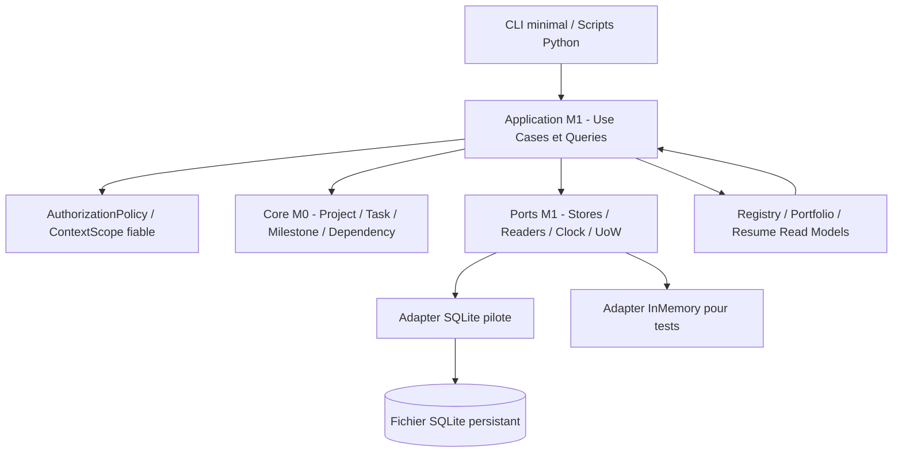

# 15 - PYPROJECTKIT - PLAN D'IMPLÉMENTATION M1 : PROJECT REGISTRY, PREUVES ET CONTINUITÉ

> **Projet** : PyProjectKit
>
> **Document** : `15_PYPROJECTKIT_M1_IMPLEMENTATION_PLAN.md`
>
> **Date** : 2026-11-03
>
> **Statut** : `PROPOSED / READY_FOR_ARCHITECTURE_REVIEW / IMPLEMENTATION_NOT_STARTED`
>
> **Jalon** : M1 - Project Registry (C1)
>
> **Autorité de qualification** : propriétaire humain du projet, selon les gates Q-R0 / Q-M0 / Q-M1
>
> **Dépendance** : M0 qualifié et contrats fondamentaux adoptés avant la mise en production ou la déclaration de M1 `GO`.
>
> **Posture** : DDD, architecture hexagonale, séparation des responsabilités, preuves vérifiables, minimisation des données et apprentissage par décisions explicites.

---

# 0. Résumé exécutif

M1 doit transformer le noyau métier M0, aujourd'hui démontré avec un adaptateur InMemory, en **registre local durable et transversal de projets**, capable de conserver l'état des projets, le travail ouvert, les décisions, les observations, les références de preuve et la transmission entre sessions.

**Question à laquelle M1 doit répondre après fermeture et relance de Python, sans consulter ChatGPT :**

> Quels projets ai-je le droit de voir ? Quel travail reste ouvert ? Quelle est la dernière observation sourcée ? Qu'est-ce qui a été réellement vérifié, sur quelle version ? Quelles décisions et inconnues subsistent ? Quelle prochaine action est possible ou pourquoi n'y en a-t-il aucune ?

Le plan reprend **exactement les quatre tranches M1-A à M1-D et les 20 WorkItems M1-01 à M1-20** de `13_PYPROJECTKIT_IMPLEMENTATION_ROADMAP(1).md` §9. Il rattache leur exécution aux **14 critères AC-013..AC-026** de `00_PYPROJECTKIT_REQUIREMENTS_ANALYSIS_V2.md` §34.

**Livrable final visé** : package Python M0 inchangé dans ses garanties de base, adaptateur durable pilote (SQLite **proposé**, non décidé), CLI minimal, registre de cinq familles de projets, journal de provenance, snapshots et handoffs, vues de reprise filtrées, tests CI et dossier Q-M1. **Ce plan n'est pas une autorisation de déployer un service multi-tenant en production ni d'importer des données privées.**

# 1. État observé au lancement du plan

## 1.1 Références GitHub vérifiées le 3 novembre 2026

| Objet | Référence | État observé |
|---|---|---|
| Dépôt | `tawounfouet/pyprojectkit` | Public, branche canonique `main` |
| Réconciliation documentaire | [PR #4](https://github.com/tawounfouet/pyprojectkit/pull/4) | `DRAFT`, ouverte, non fusionnée |
| Bootstrap M0 | [PR #6](https://github.com/tawounfouet/pyprojectkit/pull/6) | `DRAFT`, ouverte, non fusionnée |
| HEAD M0 documenté | `ab2d4246c758f70b35507ec7fe016f9344da723c` | CI GitHub Actions `41653259680` : succès sur Python 3.12 et 3.13 |
| Rapport M0 | `docs/qualification/BOOTSTRAP_REPORT.md` dans la PR #6 | 17 tests pytest et typage strict rapportés avec SHA et limites |
| Décision D-SEM-01 | Issue #2 / PR #4 | `ACCEPTED` pour la compatibilité des identifiants V1/V2 |
| Arbitrages architecturaux D-01..D-07 | [Issue #5](https://github.com/tawounfouet/pyprojectkit/issues/5) | `PROPOSED`, sans validation formelle globale |
| Qualification M0 | [Issue #7](https://github.com/tawounfouet/pyprojectkit/issues/7) | Dossier de qualification ouvert |
| Q-R0 / Q-M0 | Documents de suivi des gates | Aucun `GO` formel constaté |

**Conséquence** : les preuves CI du prototype M0 constituent une **entrée d'ingénierie**, mais ne sont ni une fusion de M0 sur `main` ni une approbation de Q-M0. La mise en chantier M1 devra choisir une baseline Git explicite, sans mélanger silencieusement les branches #4 et #6.

## 1.2 Surface logicielle M0 réellement disponible

La branche du bootstrap contient actuellement :

- `src/pyprojectkit/domain.py` : `Project`, `Task`, `Milestone`, IDs, transitions, événements et erreurs M0 ;
- `src/pyprojectkit/ports.py` : `UnitOfWork`, `ProjectRepository`, `TaskRepository`, `DependencyGraphPort`, `AuthorizationPolicy`, `ActorContext`, `Clock` et `IdFactory` ;
- `src/pyprojectkit/memory.py` : InMemory avec verrou local, snapshots de travail, validation optimiste et commit explicite ;
- `src/pyprojectkit/service.py` : façade applicative `ProjectService` ;
- tests, exemple, build et CI Python 3.12/3.13.

**Écarts à résoudre, sans prétendre qu'ils sont déjà livrés** :

1. Aucun adaptateur SQLite ni schéma durable n'est observé dans M0.
2. `ActorContext` ne contient que `actor_id` et `scope: str` ; M1 devra relier cette information à des droits fiables sur les ressources sans supposer qu'un scope auto-déclaré est une permission.
3. Les protocoles M0 sont centrés sur Project/Task/Dependency ; le registre, les preuves et snapshots appellent **des ports spécialisés**, pas une extension automatique de `ProjectRepository` pour chaque objet.
4. Le numéro `0.1.0a1` est celui du prototype ; aucune version M1 ni licence publique n'est fixée.
5. L'adaptateur InMemory ne qualifie pas la concurrence SQL, les transactions multi-processus ou la résistance à un crash.

## 1.3 Sources de spécification

- Référentiel produit : `00_PYPROJECTKIT_REQUIREMENTS_ANALYSIS_V2.md`, `00_PYPROJECTKIT_PROJECT_VISION_AND_ARCHITECTURE_V2.md`.
- Modèle métier : `04_PYPROJECTKIT_OBJETS_METIERS_V2.md`, `05_PYPROJECTKIT_ENTITIES_AND_VALUE_OBJECTS_V2.md`, `06_PYPROJECTKIT_DOMAIN_RELATIONSHIPS_AND_ERD_V2.md`.
- Règles et cas d'usage : `07_PYPROJECTKIT_DOMAIN_INVARIANTS_AND_BUSINESS_RULES_V2.md`, `08_PYPROJECTKIT_COMMANDS_QUERIES_AND_USE_CASES_V2.md`.
- Événements, stockage, échecs, sécurité : `09_..._DOMAIN_EVENTS_CATALOG_V2.md`, `10_..._REPOSITORIES_UNIT_OF_WORK_AND_PORTS_V2.md`, `11_..._ERROR_MODEL_AND_FAILURE_SEMANTICS_V2.md`, `12_..._APPLICATION_SECURITY_AND_AUTHORIZATION_V2.md`.
- Planification : `13_PYPROJECTKIT_IMPLEMENTATION_ROADMAP(1).md` §9 et `14_PYPROJECTKIT_IMPLEMENTATION_BOOTSTRAP_PLAN(1).md`.
- Méthode : `PYKIT_SOFTWARE_DESIGN_LEARNING_CONVENTION.md` et `PYPROJECTKIT_SOFTWARE_DESIGN_LEARNING_OVERLAY.md`.

**Préséance pratique** : les spécifications V2 sont des sources de propositions jusqu'à validation des ADR et des écarts. Le présent plan classe les décisions nouvelles comme **candidates** et ne les érige pas silencieusement en règles normatives.

# 2. Résultat métier, scénarios et hors périmètre

## 2.1 Premier scénario de bout en bout à prouver

1. Un propriétaire autorisé inscrit `PyProjectKit` dans le registre, puis un autre projet de nature non logicielle, chacun dans son `ContextScope`.
2. Un adaptateur SQLite pilote persiste les projets, tâches et références, avec versions et transaction.
3. L'utilisateur rattache au projet une référence externe stable et une observation horodatée dont la source et la révision sont explicites.
4. Une évaluation est conservée avec son périmètre exact, **sans déduire un `PASS` du simple lien**.
5. Une décision, un blocage et un handoff documentent l'état du projet, les incertitudes et la prochaine action ou son absence.
6. Une capture `ProjectSnapshot` immuable est créée, avec `captured_at`, scope, watermark/révisions et limites.
7. Le processus s'arrête ; un **nouveau processus** ouvre la même base et demande `GetProjectResumeContext`.
8. La réponse restitue les tâches ouvertes, décision, preuve et snapshot, avec dates/fraîcheur, sans changer les `ProjectStatus` ni `TaskStatus`.
9. Un acteur appartenant à un scope non autorisé ne voit ni le projet, ni son existence dans les comptes, facettes, erreurs, snapshots ou exports.

## 2.2 Cinq familles de pilotes (données synthétiques ou explicitement autorisées)

| Famille AC-013 | Exemple de démonstration | Contrainte de neutralité |
|---|---|---|
| Package Python | PyProjectKit en auto-pilotage | Une preuve CI peut viser un SHA exact |
| Produit | Produit logiciel fictif | Aucune obligation d'avoir un dépôt Git |
| Prestation client | Projet client fictif | Scope et données séparés, aucun secret client réel |
| Pédagogie | Module d'enseignement fictif | Pas de gate Py*Kit imposé |
| Personnel | Projet personnel fictif | Aucun relevé bancaire ou donnée sensible brute |

Ces catégories servent d'**échantillon de qualification**, pas de taxonomie universelle obligatoire.

## 2.3 Exclusions volontaires

- Pythos, agents et `OperatingBriefDTO`/`ExecutionReportDTO` (M2 uniquement).
- Sync GitHub/Drive bidirectionnelle, scrapers, authentification OAuth ou appels réseau obligatoires.
- Dashboard web riche, scheduler distribué, broker d'événements, Event Sourcing et Outbox généralisée.
- Budgets détaillés, paie, pièces bancaires, CRM, RH, Agile complet et PMO avancé (C3 ou systèmes propriétaires).
- Stockage du contenu intégral des artefacts externes pour « faire preuve ».
- Publication PyPI, traitement de données réelles non autorisées, ou certification d'un dispositif multi-tenant de production.

# 3. Architecture cible M1 et frontières DDD

## 3.1 Schéma de dépendances candidat



**Invariants d'architecture** : `domain` n'importe pas SQLite, le CLI ni Pythos ; l'application dépend de protocoles ; les adaptateurs fournissent les transactions et les lectures. Les projections ne deviennent pas une deuxième source de vérité du `ProjectStatus`.

## 3.2 Modèle canonique : responsabilité, non-duplication, durabilité

| Concept | Classification issue des V2 | Traitement M1 proposé | Interdiction |
|---|---|---|---|
| `Project`, `Task` | Aggregate Roots M0 | Persistance SQLite fidèle aux contrats M0 | Pas de nouvelle identité locale pour le même Project |
| `Milestone` | Entity interne à `Project` | Stocké par l'aggregate Project | Pas de `MilestoneRepository` arbitraire |
| `ContextScope` | Value Object M1 | Identité stable, classification et référence de policy | Scope auto-déclaré != permission |
| `ProjectRegistryEntry` | Read Model M1 | Vue/projection dérivée du Project et références | Ne pas posséder indépendamment le statut métier |
| `ExternalReference` | Référence persistable | Lien explicite, unicité composite scoped | Pas de fusion sur nom/URL seulement |
| `SourceReference` | Value Object | Provenance associée aux records | URL seule != preuve |
| `Claim` / `ObservationRecord` | Assertion / historique append-only | Séparer ce qui est affirmé et constaté | Observation != validation |
| `EvidenceRef` | Value Object immuable | Référence exacte, révision, sujet, limites | Pas de copie brute obligatoire |
| `VerificationAssessment` | Historical Record append-only | Résultat évalué par critère, version et évaluateur | `PASS(A)` != `PASS(B)` |
| `ReconciliationCase` | Issue spécialisée / Entity simple | Conflit historisé, résolution traçable | Pas de `latest()` arbitraire |
| `Decision` / `ApprovalRecord` | Historiques contextualisés | Décideur/approbateur, portée, acte et version | Proposition != approbation |
| `ProjectSnapshot` | Historical Read Model | Capture immuable, watermark, origine et lacunes | Snapshot != état live, ni Event Sourcing |
| `NextAction` | Read Model | Projection calculée et justifiée, éventuellement absente | Pas de TaskCreated automatique |
| `HandoffRecord` | Historical Record | Journal de transmission durable | Handoff != clôture de Task |

## 3.3 Organisation physique candidate

Conserver les modules M0 jusqu'à ce qu'un refactoring soit justifié. Ajouter les composants M1 par responsabilité :

```text
src/pyprojectkit/
  domain.py                        # M0, API et règles préservées
  ports.py                         # M0, ajustements versionnés si nécessaires
  service.py                       # M0, façade existante
  memory.py                        # M0, régression permanente
  registry/
    models.py                      # ContextScope, références et read models
    ports.py                       # ProjectRegistryReader, stores append-only
    use_cases.py                   # Registration, observations, décisions
    queries.py                     # Vues scope-aware, portfolio
  continuity/
    models.py                      # Snapshot, Handoff, NextAction
    ports.py
    use_cases.py
    queries.py
  adapters/
    sqlite/
      connection.py                # Transactions, FKs, pragmas
      schema.py                    # Migrations versionnées
      uow.py                       # Contrats M0 dans SQLite
      repositories.py              # Project / Task / graph
      records.py                   # Stores M1 append-only
    memory_records.py              # Double de contrat pour tests
  cli.py                           # Parsing, composition, aucun métier
migrations/
  0001_m0_entities.sql
  0002_m1_registry.sql
  0003_m1_history.sql

tests/
  contract/                        # Les mêmes contrats InMemory / SQLite
  integration/                     # Nouvelle session, migration, crash
  security/                        # Cross-scope, comptages et exports
  acceptance/                      # AC-013..026, cinq familles
```

C'est une **proposition d'arborescence**, non l'affirmation que ces fichiers existent. Si un nom de type/port existant est incompatible, produire un ADR de migration et un test de non-régression plutôt que renommer silencieusement l'API M0.

# 4. Stockage durable et contrat transactionnel

## 4.1 Adapter SQLite candidat, à décider en M1-01

**Pourquoi candidat** : fichier local, tests hors réseau, transactions, contraintes et migrations explicites, dépendance standard library possible via `sqlite3`. Ce n'est ni une garantie de durabilité multi-serveur ni le choix imposé pour une future production distribuée.

**Critères de décision** : coût d'exploitation local, compatibilité Python 3.12/3.13, atomicité inter-repositories, sérialisation contrôlée, stratégie de sauvegarde, récupération après crash, conflits de versions, taille des projections, test de substitution.

## 4.2 Modèle logique initial candidat

| Ensemble de tables / stores | Raison | Clé(s) / contraintes visées |
|---|---|---|
| `schema_migrations` | Version du schéma | Migration id et checksum |
| `projects`, `tasks`, `project_milestones`, `task_dependencies` | Vérité locale M0 durable | IDs stables, FKs, versions, unicité, graphe sans cycle vérifié par domaine |
| `context_scopes`, `project_scope_links` | Portée et ownership | ScopeId stable, relation autorisée, classification |
| `external_references`, `source_references` | Liens/provenance | `(provider, external_id, scope_id, relation_type)` ou équivalent approuvé |
| `claims`, `observations`, `evidence_links` | Assertions et constats | Append-only logique, IDs immuables, timestamps et scope |
| `verification_assessments` | Conclusions sur sujet/version | Référence cible exacte, méthode, évaluateur, limites |
| `reconciliation_cases`, `reconciliation_history` | Conflits et résolutions | Identités sources conservées, décision tracée |
| `decisions`, `approval_records`, `blockers` | Gouvernance | Acteur habilité, portée, horodatage et état de l'acte |
| `project_snapshots`, `handoff_records` | Continuité historique | Capture immutable, sujet/scope, watermark, référence et supersession |
| `registry_projection_cache` (OPTIONNEL) | Performance de lecture | Reconstruisible, fraîcheur/révision affichées |

La séparation en tables, les schémas SQL exacts et le modèle de sérialisation sont **à valider en ADR M1**. Ne pas créer `registry_projection_cache` avant mesure ou besoin de lecture démontré.

## 4.3 Transactions, concurrence et reprise

- Les opérations M0 touchant Project/Task/graphe gardent leur **UoW commune**. Les records M1 associés sont écrits dans la même transaction si le cas d'usage réclame une cohérence atomique ; sinon leur éventuelle convergence est explicitée.
- Le pilotage des conflits utilise `expected_version` et des mises à jour conditionnelles, avec révision commune de graphe. Deux processus distincts doivent être testés sur **le même fichier SQLite**.
- SQLite utilise des transactions explicites et des contraintes (`FOREIGN KEY`, `UNIQUE`, version) ; `BEGIN IMMEDIATE`, WAL et `busy_timeout` sont des **options d'implémentation à mesurer** et non des preuves d'isolation par leur seule activation.
- Ne jamais utiliser `pickle` pour interpréter une donnée non fiable. Préférer colonnes typées et payloads JSON avec version de schéma lorsque justifié, validateurs et migrations explicites.
- `save()` ne commite pas ; absence de `commit()` ou exception avant commit = rollback. Le succès d'un test `sqlite3` ne prouve pas la sûreté sous crash non testé.
- Un timeout après demande de commit peut rendre son résultat incertain. Identifier opération/correlation, relire et réconcilier avant retry, sans déclarer un rollback fictif.
- Les migrations ont une politique `up` versionnée, checksum et sauvegarde de test. La stratégie de `down`/restauration est à documenter : un rollback de schéma destructif n'est **pas** présumé sûr.
- Une archive SQLite ou une copie de base est une donnée sensible selon ses scopes ; aucun artefact contenant des projets réels n'est uploadé en CI ou dans le dépôt public.

# 5. ContextScope, identité et confidentialité

## 5.1 Contrat cible

Le périmètre de M1 introduit une identité stable `ScopeId`, une classification, un owner et éventuellement une référence de policy. Le modèle M0 `ActorContext(actor_id, scope: str)` est une base limitée : il doit être **étendu ou adapté via une décision de compatibilité**, et non utilisé comme autorisation à la seule lecture d'une chaîne de scope.

Les ports d'Application doivent disposer d'un acteur **établi par l'hôte**, d'une permission, d'une cible et d'une portée effectivement autorisées. Le système doit fonctionner avec des politiques différentes selon les espaces, tout en laissant le domaine M0 générique.

## 5.2 Contrôles de non-divulgation

- Filtrer à la **source de la Query** puis calculer comptes, facettes, pagination et suggestions ; ne pas filtrer après le comptage.
- Une ressource cachée ne doit pas être révélée par un `NotFound` distinctif, un message SQL, un identifiant externe ou une recommandation de NextAction.
- Les enfants (Task, EvidenceRef, Decision, Snapshot) peuvent être plus restrictifs que leur Project.
- Les exports, traces, logs, erreurs, exceptions et identifiants de corrélation sont soumis à la même politique de visibilité.
- Une lecture transverse de cinq familles et plusieurs scopes n'est pas une superpermission. Un filtre `scope` fourni en CLI ne confère aucun droit.
- Les données client/employeur et financières ne sont utilisées que si expressément autorisées ; **par défaut : fixtures synthétiques**.
- Il faut un test de permissions par catégorie de ressources et un test de fuite sur **les totaux et le curseur de pagination**.

## 5.3 Décisions de sécurité à formaliser

- Modèle `ActorContext` étendu et source de confiance, compatibilité avec l'API M0.
- Permission M1 par sujet (Registry, Observation, Evidence, Assessment, Snapshot, Handoff, Decision, Export) et refus par défaut.
- Stratégie `PERMISSION_DENIED` versus `NOT_FOUND` masqué, sans side channel informatif.
- Classification, rétention, purge, sauvegarde et éventuelle exportabilité selon policy du scope.

# 6. Modèle de connaissance et preuves avant statut

## 6.1 Trois couches différentes

1. **Claim** : ce qu'un humain, un outil ou une source affirme, avec sujet et portée.
2. **ObservationRecord** : ce qui a été constaté à un instant précis, avec `observed_at`, `recorded_at`, producteur, référence source et limites.
3. **VerificationAssessment** : ce qu'une évaluation conclut **sur une référence cible exacte**, avec critère, évaluateur, méthode, date, evidence et résultat `PASS|FAIL|PARTIAL|UNKNOWN`.

`EvidenceRef` indique **où consulter** la pièce et à quelle version, sans devenir une validation en soi. `VERIFIED` et `APPROVED` restent distincts, comme `DONE` et `QUALIFIED`.

## 6.2 Erreurs et conflits

- Référence mal formée : refus de validation locale.
- Source inaccessible : `SOURCE_UNAVAILABLE` ou `UNKNOWN`, avec date de dernière observation ; jamais `PASS` déduit.
- Lien ambigu : `AmbiguousExternalReference`, conservation des candidats et éventuel `ReconciliationCase`.
- Deux sources contradictoires : deux observations conservées, ouverture d'un conflit ; pas de `first()`/`latest()` silencieux.
- Évaluation SHA A appliquée à SHA B : preuve insuffisante ou `UNKNOWN` pour B, indépendamment du `PASS` de A.
- Correction d'une observation : append d'une nouvelle version / relation de supersession, pas écrasement du record originel.
- Une décision humaine est attribuée à son autorité ; un rapport, un statut `DONE` ou un attribut `approved_by` non fiable n'accordent aucun droit.

# 7. Continuité, snapshots, handoffs et projections

- `ProjectSnapshot` est une **capture immutable** : `snapshot_id`, ProjectId, ScopeId, `captured_at`, révisions, fraîcheur, provenance `ORIGINAL|RECONSTRUCTED|PARTIAL|UNKNOWN`, lacunes et références filtrées.
- Une capture ne doit pas prétendre être atomique si les sources ont été lues à des révisions différentes. Soit utiliser un snapshot transactionnel prouvé, soit consigner les watermarks et `incomplete_sections`.
- `HandoffRecord` : sujet, producteur, résultat, références exactes, tests déclarés, décisions attendues, risques, inconnues et recommandation. **Il ne clôture pas Task.**
- `NextAction` : projection justifiée, liée à une Task existante lorsque possible ; l'absence peut être une sortie valide (`NONE_WITH_REASON`). Une suggestion n'est pas une commande de création de tâche.
- `ResumeContextReader` : agrège les seules données autorisées, annonce la fraîcheur et l'incomplétude, ne modifie jamais le domaine en lisant.
- `PortfolioDecisionKind` (
  `KEEP`, `MERGE`, `PARK`, `RETIRE`) ne s'applique que sous une policy qui le prévoit. `PARK` **ne modifie pas** automatiquement `ProjectStatus.ON_HOLD`.

# 8. Roadmap opérationnelle M1-A à M1-D

**Notation** : P0 = invariant, sécurité ou durabilité bloquante ; P1 = scénario pilote complet ; P2 = amélioration mesurée. Tous les statuts sont **`NOT_STARTED`** au moment de ce plan. Les lots sont des tranches *verticales*, pas la création de couches vides.

## 8.1 M1-A - Stockage durable et classification transverse

| ID | Priorité | Objectif et livrable vérifiable | Dépendances | AC / tests de preuve |
|---|---|---|---|---|
| `M1-01` | P0 | Choisir l'adaptateur durable pilote (SQLite candidat), ADR de stockage, règles de migration et recovery | Q-M0, ADR-M1-01 | Décision + tests de faisabilité SQL |
| `M1-02` | P0 | Implémenter SQLite UoW, Project/Task/Dependency Repositories, versions et migrations sans casser M0 | M1-01 | AC-015 ; contract suite InMemory/SQLite, restart, rollback |
| `M1-03` | P1 | `ProjectRegistryEntry` dérivé + cinq familles + `ListProjects/Registry` | M1-02 | AC-013/014 ; ProjectId unique, absence de Git forcée |
| `M1-04` | P0 | `ContextScope` stable et policy d'accès sur Commands/Queries | M1-01/02 | AC-024/026 ; scope invisibilité et deny-default |
| `M1-05` | P1 | CLI minimal : enregistrer, lier référence, lister, consulter, relire après restart | M1-03/04 | AC-013..015 ; subprocess offline |

**Gate local `G-M1-A` (proposé)** : même scénario de Project/Task persistant sur deux processus, pas de perte de versions, aucun résultat inter-scope. **Aucun GO M1 global à ce stade.**

## 8.2 M1-B - Observations, preuves, réconciliation

| ID | Priorité | Objectif et livrable vérifiable | Dépendances | AC / tests de preuve |
|---|---|---|---|---|
| `M1-06` | P1 | Stores de références externes et sources avec identifiants, révision, provenance et unicité scoped | M1-02/04 | AC-019/020 ; 0/1/N candidats |
| `M1-07` | P0 | `Claim`, `ObservationRecord`, `EvidenceRef` séparés ; append-only et correction par supersession | M1-06 | AC-016/019 ; timestamps et lien cassé |
| `M1-08` | P0 | `VerificationAssessment` attaché au sujet/critère/SHA, `UNKNOWN` sûr par défaut | M1-07 | AC-017/018/021 ; SHA A vs SHA B |
| `M1-09` | P1 | `ReconciliationCase` pour contradictions, candidats concurrents et provenance | M1-07/08 | AC-020 ; deux sources intactes après résolution |
| `M1-10` | P0 | Journal de décisions, approbations et pouvoirs distincts des observations | M1-04/07 | AC-021/023 ; décision hors mandat refusée |

**Gate local `G-M1-B` (proposé)** : aucune source cassée ne devient `VERIFIED`, aucun `PASS(A)` n'est transporté à B, aucun conflit n'efface son historique, aucune suggestion n'est convertie automatiquement en approbation.

## 8.3 M1-C - Continuité, mémoire opérationnelle et portefeuille

| ID | Priorité | Objectif et livrable vérifiable | Dépendances | AC / tests de preuve |
|---|---|---|---|---|
| `M1-11` | P0 | Snapshot immutable, daté et versionné avec watermarks et incomplétudes | M1-02/07/10 | AC-015 ; timestamp et limites |
| `M1-12` | P1 | `NextActionReader` et projection justifiée, y compris absence explicite | M1-03/10/11 | AC-014/022 ; pas de Task dupliquée |
| `M1-13` | P1 | `HandoffRecord` append-only avec résultat, preuves, risques, inconnues, suivante | M1-07/11 | AC-015/021 ; deuxième handoff conservé |
| `M1-14` | P0 | `ResumeContextReader` + vues portefeuille filtrées avant agrégation | M1-04/11/12/13 | AC-014/015/023/024 ; subprocess, non-divulgation |
| `M1-15` | P1 | `PortfolioPolicy` et approbations selon catégorie/scope, sans statuts Py*Kit universels | M1-10/14 | AC-025/026 ; `PARK` != `ON_HOLD` |

**Gate local `G-M1-C` (proposé)** : une nouvelle session retrouve l'état visible, le snapshot historique n'est pas présenté comme live et l'absence de prochaine action n'est pas masquée.

## 8.4 M1-D - Pilotes et qualification de la continuité

| ID | Priorité | Objectif et livrable vérifiable | Dépendances | AC / tests de preuve |
|---|---|---|---|---|
| `M1-16` | P1 | Dogfooding PyProjectKit : roadmap, décisions et preuves versionnées dans son propre registre | M1-C | AC-014/015 ; données de démo propres |
| `M1-17` | P1 | Quatre autres familles synthétiques, total cinq ; critères et owners divers | M1-03/15/16 | AC-013/025/026 ; aucun champ technique obligatoire |
| `M1-18` | P0 | Tests reprise/redémarrage, crash, backup, migration, conflits et version | M1-02/11/13/17 | AC-015 ; scénario subprocess et réouverture |
| `M1-19` | P0 | Tests offensifs de fuite inter-scopes sur Query, page, filtre, total, export, log | M1-04/14/18 | AC-024/026 ; zéro fuite observée selon suite |
| `M1-20` | P0 | Matrice AC-013..026, rapports SHA, risques, ADR, handoff et verdict Q-M1 | M1-01..19 | Quatorze AC réellement exécutés, revue humaine |

**Gate local `G-M1-D` (proposé)** : pilotes autonomes, tests d'intégration sur base fraîche et migrée, reprise sans conversation, sécurité négative, preuve de qualification sur SHA exact. Le statut global reste `NOT_ASSESSED` jusqu'à décision humaine.

# 9. Premier vertical slice M1 recommandé

**But** : une PR verticale prouvant la durabilité M0 sans complexifier prématurément le modèle des preuves.

### VS-M1-01 - `Persist -> Stop -> Restart -> Resume`

1. ADR de stockage et scope minimal approuvés.
2. Initialiser une base SQLite vierge et appliquer `0001_m0_entities.sql`.
3. Depuis `ProjectService`, créer Project et Task dans un contexte autorisé.
4. Fermer complètement le processus après commit.
5. Démarrer un **nouveau processus indépendant**, ouvrir la même base via `SqliteUnitOfWork` et lire Project/Task avec leurs IDs, statut et versions.
6. Rejouer les contrats InMemory sur SQLite : rollback, lecture isolée, conflit optimiste et dépendance acyclique.
7. Tenter une lecture depuis un autre scope : résultat non-divulgant, sans compte ni identifiant.
8. Publier dans la PR le SHA, la commande de test, les logs et les écarts observés.

**DoD du vertical slice** : `AC-015` **partiellement démontré** (durabilité Project/Task), pas déclaré PASS complet tant que décisions, dernier snapshot, contexte de reprise et tâches ouvertes ne sont pas également couverts. Aucun code SQLite autoritaire dans `domain.py`.

### VS-M1-02 - `Observe -> Verify -> Reconcile`

Ajouter référence exacte, observation, claim, evidence et assessment ; démontrer les cas source inaccessible, SHA A/B et contradictions. Le verdict n'est jamais dérivé de la seule présence d'une URL.

### VS-M1-03 - `Snapshot -> Handoff -> Resume`

Créer un snapshot daté, record de handoff et NextAction. Redémarrer, restituer un contexte autorisé avec dates et limitations ; distinguer l'état courant de la capture historique.

### VS-M1-04 - `Five families -> Scoped portfolio -> Q-M1`

Enregistrer les cinq familles synthétiques, comparer deux politiques de validation, exécuter tous les tests négatifs de scopes et clôturer la matrice AC.

# 10. Catalogue de Commands, Queries et ports candidats

## 10.1 Commands prioritaires issus du document 08 V2

| Catégorie | Commands / Use cases M1 à réaliser progressivement |
|---|---|
| Registre | `RegisterProjectInRegistry`, `LinkExternalProjectReference`, `RecordPortfolioDecision` |
| Connaissance | `RecordWorkObservation`, `AttachEvidenceReference`, `RecordVerificationAssessment`, `OpenReconciliationCase`, `ResolveReconciliationCase` |
| Continuité | `CaptureProjectSnapshot`, `RecordHandoff`, `ProposeNextAction` (projection possible, non nécessairement mutation) |
| Gouvernance | `RecordDecision`, `RecordBlocker`, `ApproveDecision` seulement sous contrat d'autorité approuvé |

Les identifiants précis `AUC-M1-R*`, `AUC-M1-E*`, `AUC-M1-C*`, `AUC-M1-G*` restent documentés dans `08_PYPROJECTKIT_COMMANDS_QUERIES_AND_USE_CASES_V2.md` §§14-17. **Ne pas créer 20 services distincts par réflexe** : regrouper par responsabilité et transaction, une API publique minimale à la fois.

## 10.2 Queries à rendre lisibles et sûres

`ProjectRegistryReader`, `PortfolioReader`, `GetProjectResumeContext`, `GetProjectSnapshot`, `GetVerificationStatus`, `ListProjectObservations`, `GetEvidenceForSubject`, `ListReconciliationCases`, `GetProjectDecisionLog`, `ListNextActions`, `GetSourceFreshness`.

Une Query n'a pas le droit d'actualiser silencieusement GitHub ni de modifier la vérité métier. Les vues partielles exposent `incomplete_sections`, `source_freshness` et les limites ; les tris/pages doivent être déterministes sous les conditions annoncées.

## 10.3 Ports à introduire seulement pour les invariants démontrés

- Durabilité M0 : `SqliteUnitOfWork`, `ProjectRepository`, `TaskRepository`, `DependencyGraphPort`, migration store.
- Catalogue : `ProjectRegistryReader`, `PortfolioReader`, `ExternalReferenceStore`.
- Provenance : `ObservationStore`, `EvidenceReferenceStore` si un contrat de lien autonome existe, `VerificationAssessmentStore`, `ReconciliationStore`.
- Continuité : `ProjectSnapshotStore`, `HandoffStore`, `ResumeContextReader`, `NextActionReader`.

Le VO `EvidenceRef` **n'impose pas** un `EvidenceRepository` Aggregate Root. `ProjectRegistryEntry` ne crée pas une deuxième vérité du Project.

# 11. Matrice de qualification AC-013 à AC-026

> **Statut de tous les critères : `NOT_EXECUTED` pour M1.** Les cas ci-dessous sont les preuves à produire, pas des résultats observés.

| AC | Scénario de recette à automatiser | WorkItems | Preuve ciblée |
|---|---|---|---|
| `AC-013` | Inscrire et rechercher cinq familles de projets sans Git/sprint obligatoires | 03, 16, 17 | Tests de cinq fixtures |
| `AC-014` | Vue owner, état, priorité, échéance, prochaine action sans colonnes techniques forcées | 03, 12, 14 | Snapshot CLI/Query et assertions |
| `AC-015` | Stop/restart : dernier snapshot, décisions, tâches ouvertes et handoff retrouvés | 02, 11, 13, 14, 18 | Deux processus et schéma migré |
| `AC-016` | `UNKNOWN/DECLARED/OBSERVED/VERIFIED` séparés de `ProjectStatus` | 07, 08 | Tests de non-promotion |
| `AC-017` | Rejeter `PUBLISHED` sans preuve selon policy logicielle | 08, 10 | Refus sans modification |
| `AC-018` | Vérification CI SHA A n'autorise pas verdict sur SHA B | 08 | Deux références exactes |
| `AC-019` | Source cassée = `UNKNOWN`/indisponible, jamais `PASS` | 06, 07, 08 | Faux lien, évaluation bornée |
| `AC-020` | Deux observations contradictoires subsistent avec conflit à résoudre | 07, 09 | Historiques avant/après résolution |
| `AC-021` | `Task.DONE` n'accepte pas automatiquement un livrable | 08, 10, 13 | Test événement/statut/approbation |
| `AC-022` | Pas de NextAction possible => absence et raison explicites | 12 | `None`/vue explicable sans TaskCreated |
| `AC-023` | `Portfolio.PARK` et `Project.ON_HOLD` restent deux dimensions | 10, 14, 15 | Deux projets et policy |
| `AC-024` | Aucune fuite hors scope via liste, compte, facette, page, snapshot, export | 04, 14, 19 | Suite négative multi-acteurs |
| `AC-025` | Projet financier fictif suivi sans relevé ni secret | 15, 17 | Inspection schéma, fixture et export |
| `AC-026` | Deux politiques de validation diffèrent sans modifier le core | 04, 15, 17, 19 | Deux policies + mêmes use cases |

**Contrôles additionnels** : `AC-M1-01..12` de `08 V2 §19`, contrat des Repositories durables, reprises de migration, conflit de versions, fail-closed, absence de couplage Pythos, tests de provenance et immutabilité historique.

# 12. Stratégie de tests, CI et preuves

## 12.1 Suite contractuelle

- Rejouer **les mêmes tests de contrats M0** sur l'InMemory et sur SQLite. Les tests ne présument pas que l'ordre de `list_all()` est stable sans règle de tri.
- Tests InMemory : rapides, déterministes, pour logique métier et policies.
- Tests SQLite fichier temporaire : transactions, contraintes, schema version, corruption et migrations.
- Tests avec deux connexions **et deux processus** : write conflicts, graphe, redémarrage, erreurs de verrouillage et reprise.
- Tests de « crash » : provoquer une interruption avant commit, puis après commit, et distinguer résultats confirmés des issues inconnues. Séparer simulation de failpoint et processus tué réellement.
- Tests d'isolation : actor A/B, scope personnel/client/pédagogie, liens externes ambigus, vues de portefeuille, pages/exports et logs.
- Tests de provenance : `recorded_at` distinct de `observed_at`, watermark, snapshot `PARTIAL`, erreur de source, SHA A/B.
- Tests de non-régression : toutes les transitions M0, événements après commit, API publique et exemples existants.

## 12.2 CI proposée

1. Python 3.12 et 3.13, environnement neuf sans réseau requis pour le noyau à l'exécution.
2. Installation du package ; tests M0 + M1, `mypy --strict`, lint défini dans l'ADR de tooling, vérification des frontières d'imports.
3. Build wheel + sdist puis smoke tests de la **distribution installée**, pas uniquement du working tree.
4. Adapter SQLite : initialisation/migration d'une DB neuve et d'une ancienne version fixture ; rollback et UoW ; tests de reprise via sous-processus.
5. Tests de sécurité négatifs et isolation des scopes obligatoires.
6. Génération du rapport des `AC-013..026` sur **le même SHA de code** et conservation des logs.
7. Ne pas uploader les bases de données contenant des informations privées. Les fixtures GitHub/produit/client/personnelles doivent être synthétiques.

**Niveaux de preuve** : `TEST_PASSED` concerne une assertion sur un environnement donné ; `ADR_ACCEPTED` concerne une décision humaine ; `Q-M1_GO` concerne l'ensemble de la capacité qualifiée. Ne jamais les fusionner.

# 13. Stratégie de PR, branches et séquencement

La PR documentaire M1 doit rester indépendante de la PR M0 tant que la baseline n'est pas approuvée. **Branche d'implémentation proposée après gate** : `feat/m1-registry-bootstrap`, depuis le SHA M0 **accepté**, et non une branche arbitraire non fusionnée.

| Ordre | Type de PR candidate | Périmètre borné | Condition de fusion |
|---|---|---|---|
| P1 | `docs(M1): ADR stockage, scopes et modèle de registre` | ADR M1, migrations proposées, nomenclature | Revue humaine, impact M0 mesuré |
| P2 | `feat(M1-A): sqlite durability & core contracts` | M1-01/02/04, migration 0001 | Contrats M0, restart, sécurité, CI |
| P3 | `feat(M1-A): registry & CLI` | M1-03/05 | AC-013/014, visibilité et smoke |
| P4 | `feat(M1-B): provenance and verification` | M1-06..10 | SHA A/B, append-only, conflits, autorisations |
| P5 | `feat(M1-C): snapshots, handoff, resume` | M1-11..15 | Snapshot historique, NextAction et reprise |
| P6 | `test(M1-D): pilot matrix & Q-M1 evidence` | M1-16..20 | AC-013..026, tests négatifs, verdict humain |

Les frontières PR sont **indicatives** : préférer moins de PR si les tests atomiques l'exigent ; ne pas casser un parcours utilisable entre merges. Une CI verte ne fusionne rien par elle-même.

# 14. Décisions d'architecture M1 à préparer

| ADR candidat | Question de décision et position de travail | Risque si non tranché |
|---|---|---|
| `ADR-M1-01` | SQLite local pilote ou autre adapter ? Sauvegarde, migrations, compatibilité M0 | Durabilité illusoire |
| `ADR-M1-02` | Schéma et sérialisation stables : JSON contrôlé, FKs, version/optimistic locking | Perte/corruption et migrations fragiles |
| `ADR-M1-03` | `ContextScope`, ActorContext fiable, policy ressource/scope | Fuite inter-contextes |
| `ADR-M1-04` | Identité ProjectRegistry et unicité des ExternalReferences | Doublons et rapprochement arbitraire |
| `ADR-M1-05` | Claim/Observation/EvidenceRef et immutabilité logique | Faux PASS, provenance effacée |
| `ADR-M1-06` | VerificationAssessment et résultats exacts par révision | Qualification d'une mauvaise version |
| `ADR-M1-07` | ReconciliationCase, conflits et autorité de résolution | Source contradictoire écrasée |
| `ADR-M1-08` | Capture Snapshot et cohérence temporelle multi-source | Faux état courant |
| `ADR-M1-09` | NextAction, handoff et supersession | Duplication Task, reprise trompeuse |
| `ADR-M1-10` | Classification, rétention, suppression, exports et logs | Persistance de données sensibles |
| `ADR-M1-11` | Contrats substituables InMemory/SQLite, erreurs et concurrence | Faux résultats multi-adapters |
| `ADR-M1-12` | Évolution compatible de l'API M0 et de la licence/version | Rupture de package, diffusion non autorisée |

**Priorité de revue** : ADR-M1-01/02/03/04/05/08 et impact D-01..D-07 avant la première mutation durable. Les autres peuvent être décidées avant leur tranche concernée si les hypothèses ne changent pas les garanties initiales.

# 15. Risques et mesures de mitigation

| Risque | Impact | Mitigation / test de sortie |
|---|---|---|
| Rupture de contrat M0 | Haut | Tests de contrat et comparaison d'API avant merge |
| Projet dupliqué dans le Registry | Haut | ProjectId canonique, liens externes scoped, cas 0/1/N |
| Mutation visible malgré rollback SQLite | Critique | Test multi-repository, crash avant commit, vérification WAL/contraintes |
| Cycle créé par deux transactions | Critique | Version commune du graphe et test deux processus |
| Lecture hors scope via compte/facette | Critique | Filtrage avant agrégation, fixtures adversariales, export contrôlé |
| SHA obsolète qualifié | Critique | Assessment par référence exacte, refus de promotion |
| Snapshot périmé présenté comme actuel | Haut | Date capture, provenance, fraîcheur et limitations obligatoires |
| Sur-modélisation Event Sourcing/Outbox | Moyen | Append-only ciblé, pas de broker par défaut |
| Fuite de données sensibles du portefeuille | Critique | Scopes, minimisation, fixtures synthétiques, pas de relevés bruts |
| Schéma SQLite non migrable | Haut | Fixtures de DB ancienne, migrations atomiques, sauvegarde et échec contrôlé |
| Couplage obligatoire à Pythos | Haut | Test d'import/usage offline sans SDK Pythos |
| Publication sans licence ou gate | Haut | PR brouillons, aucune release automatique, validation humaine |

# 16. Gates et règles GO / CONDITIONAL GO / NO-GO

## 16.1 Préconditions de démarrage d'implémentation M1

- [ ] Baseline M0 Git identifiée et qualifiée pour les contrats réutilisés ; enregistrer SHA exact.
- [ ] Q-R0 et Q-M0 explicitement évalués selon leur processus, ou dérogation humaine de **développement expérimental seulement**, documentée, sans présumer une qualification.
- [ ] D-01..D-07 et D-SEM-01 réconciliés avec les sources canoniques M0 et les impacts M1.
- [ ] ADR de stockage et de scope approuvés avant écriture de données durables.
- [ ] Licence, politique de branches, dépôts et visibilité des fixtures définis pour le périmètre de développement.

**Règle** : un ordre de commencer le code autorise le travail explicitement mandaté, mais ne remplace pas les gates ni la validation de publication, sécurité ou déploiement.

## 16.2 Gate Q-M1

**GO proposé** seulement si :

1. `AC-013..AC-026` disposent de preuves ciblées, exécutées sur SHA exact, avec logs et environnements ;
2. l'état survit à un **redémarrage réel** et les migrations n'altèrent ni identité ni historique ;
3. InMemory et SQLite respectent les garanties communes revendiquées ;
4. observations contradictoires, preuves insuffisantes et sources indisponibles restent visibles sans `PASS` fictif ;
5. `ContextScope` et décisions de permission protègent **toutes** les Queries, agrégats, snapshots, exports, comptes et traces ;
6. cinq familles de projets sont utilisables naturellement, sans outil externe obligatoire ;
7. le handoff et la NextAction sont explicables, et l'absence d'action est affichable ;
8. le dossier contient ADR, risques, limites, rapport de migration et **approbation humaine datée**.

**CONDITIONAL GO** : uniquement pour un usage local/pilote borné, avec réserves explicites, owner, échéance et tests de suivi ; jamais si la confidentialité, le rollback, l'identité des preuves ou la reprise sont compromis.

**NO-GO** si : fuite cross-scope, données persistées malgré rollback annoncé, source cassée promue `PASS`, snapshot ancien présenté comme live, remplacement silencieux de contradictions, dépendance à une mémoire de conversation ou absence de preuve sur la version annoncée.

La décision Q-M1 n'autorise ni M2/Pythos, ni une publication PyPI, ni une production multi-tenant : celles-ci ont leurs propres mandats et gates.

# 17. Definition of Done et dossier de handoff M1

Pour **chaque WorkItem M1-XX** :

- Identifiant, owner, branche/SHA, préconditions et ADR connus ;
- effet utilisateur observable et périmètre inclus/exclu ;
- résultat positif + refus métier + cas de panne/limite testés ;
- tests `pytest`, typage, qualité et frontières réellement exécutés ;
- compatibilité M0 et effet sur le schéma/permission évalués ;
- aucun statut `PASS` sans résultat et référence exacts ;
- logs/artefacts synthétiques conservés selon classification ;
- risques résiduels, rollback et prochaine action identifiés ;
- revue humaine lorsque le ticket modifie une policy, migration, schéma d'autorité ou gate.

**Rapport final BOOT-M1 / Q-M1 à produire** :

```text
Référence Git : dépôt / branche / SHA
Versions Python et SQLite + OS / dépendances
ADR adoptés et exceptions
Migrations de schéma et backups de test
Matrice AC-013..AC-026 avec logs
Sécurité : refus, scopes, exports, comptes et traces
Durabilité : stop/restart, crash et conflits
Provenance : observations, conflits, SHA et fraîcheur
Cinq familles de pilotes et policy non logicielle
Handoff et résumé de reprise
Risques et limitations
Décision humaine Q-M1 : GO / CONDITIONAL GO / NO-GO / NOT_ASSESSED
Next safe action
```

# 18. Exécution immédiate recommandée (sans démarrer M1)

1. Publier ce plan **en PR documentaire brouillon** et créer **une issue M1 parent**, sans générer vingt issues non priorisées.
2. Réviser D-01..D-07 et constater formellement la qualification M0 et les deux PR ouvertes ; ne pas présumer la fusion.
3. Décider les ADR-M1-01/02/03 minimaux : SQLite, migrations, identité et autorisation.
4. Fixer la baseline source et la suite de contrats InMemory/M0 à réutiliser.
5. Préparer les fixtures synthétiques des cinq familles et les deux scopes hostiles.
6. Après mandat : commencer **VS-M1-01**, exécuter les tests de redémarrage et documenter le premier SHA.
7. Ne créer les autres tickets détaillés qu'au fur et à mesure de leur tranche et de leurs dépendances.

---

# Annexe A. Checklist de revue du plan

- [ ] La feuille de route `M1-01..M1-20` est bien respectée.
- [ ] Tous les critères `AC-013..AC-026` sont reliés à des tests et aux WorkItems.
- [ ] Le type `ProjectRegistryEntry` ne duplique pas l'autorité de Project.
- [ ] Le modèle distingue Claim / Observation / EvidenceRef / VerificationAssessment / Approval.
- [ ] La preuve cible une version précise ; aucun SHA réutilisé sans contrôle.
- [ ] Le modèle respecte `recorded_at != observed_at` et snapshot historique != live.
- [ ] Aucun champ CLI ou API n'octroie par lui-même une permission de scope.
- [ ] Les requêtes sont filtrées **avant** compte/pagination/export.
- [ ] Une NextAction peut être absente ; un handoff ne termine pas Task.
- [ ] Le cas personnel/financier n'importe aucun relevé brut.
- [ ] M0 est conservé dans la suite de non-régression.
- [ ] L'architecture ne dépend pas obligatoirement de Pythos.
- [ ] Les ADR et les gates sont formulés comme décisions en attente.
- [ ] Aucune date, estimation ni qualification n'est inventée.

# Annexe B. Exemple de ticket M1 prêt à développer

```markdown
## M1-02 - Persistance transactionnelle SQLite

- Statut : NOT_STARTED
- Pourquoi : reprise M0 après fermeture du processus (AC-015)
- Préconditions : Q-M0 ou mandat expérimental explicite, ADR-M1-01/02, baseline SHA
- Entrée : ProjectRepository, TaskRepository, DependencyGraphPort et UnitOfWork M0
- Résultat : un Process A crée Project et Task, Process B les retrouve après restart
- Inclus : migrations, versions, rollback, graphe sous concurrence locale
- Exclu : sync GitHub, Outbox, IAM, dashboard web
- Positive : create/commit/restart/read identités et versions identiques
- Negative : exception sans commit, conflit de version, permission refusée
- Fault : interrompre Process A avant commit et constater absence de demi-écriture
- Preuves : CI Linux/Python 3.12/3.13 sur SHA, logs subprocess, schéma migré
- Sécurité : fixtures de scopes synthétiques, aucune donnée privée
- ADR : ADR-M1-01/02/03
- Risques : verrou SQL, version de graphe, migration non réversible
- Rollback : fermer transaction, restaurer DB fixture sauvegardée selon protocole
- Décision : attente de validation humaine du PR/gate applicable
```

# Annexe C. Trace des sources et révisions

| Source | Partie utilisée | Statut dans ce plan |
|---|---|---|
| Roadmap 13 (2026-11-02) | §9 : M1-A..D, M1-01..20, gate M1 ; §15 : AC | Base structurante |
| Requirements 00 V2 | §33 : définition M1 ; §34 : AC-013..026 | Critères de recette |
| 05 V2 | §§18..30 : classifications et invariants des objets M1 | Modèle métier proposé |
| 06 V2 | Relations et ERD M1, timestamps et sources | Contrôles de relations |
| 07 V2 | Invariants du registre, observations, snapshots et sécurité | Règles proposées, dépendance à la réconciliation R0 |
| 08 V2 | §§14..19 : Commands, Queries et tests M1 | API applicative candidate |
| 09 V2 | §§16..21 : Domain Events M1 | Distinction événement / observation |
| 10 V2 | §§20..29 : Readers, stores, UoW | Ports et stratégie de persistance |
| 11 V2 | §§24..33 : erreurs de sources, preuves et scopes | Failure semantics |
| 12 V2 | ContextScope, protection des lectures/exports, refus | Sécurité applicative |
| Bootstrap M0 GitHub PR #6 | Code actuel, ports, UoW et CI | État observé, non `GO` |
| Convention / Overlay Py*Kit | Méthode de conception, ADR et tests | Apprentissage et gouvernance |

**Conclusion** : M1 ne consiste pas à ajouter une base de données au CRUD M0. Il consiste à construire une **continuité durable, sourcée et autorisée** entre des projets hétérogènes, tout en conservant la séparation entre état métier, connaissance observée, preuve vérifiée et décision humaine.

# Addendum D - Arbitrages M0/M1 du 3 novembre 2026

> **Nature** : actualisation après publication initiale du plan, sans effacer son historique.
>
> **Mandat de cadrage technique délégué** : https://github.com/tawounfouet/pyprojectkit/issues/8#issuecomment-6607173475
>
> **Statut M1** : `DESIGN_ACCEPTED_FOR_LOCAL_PILOT / IMPLEMENTATION_NOT_STARTED`.

## D.1 Qualification M0 consolidée

La [consolidation technique M0](../qualification/2026-11-03_M0_TECHNICAL_QUALIFICATION_CONSOLIDATION.md) vérifie la CI GitHub Actions `41653259680` sur le SHA de la PR #6 `ab2d4246c758f70b35507ec7fe016f9344da723c`. Les deux jobs Python 3.12/3.13 sont `SUCCESS`, avec **17 tests réussis chacun**, wheel construite et `mypy --strict` sans erreur. Ce résultat qualifie **le prototype InMemory dans le périmètre testé**, pas une base SQLite ni un service sécurisé multi-tenant.

Les gates `Q-R0` et `Q-M0` restent `NOT_ASSESSED` : les ADR M0 D-01..D-07, la baseline documentaire, la licence et l'autorisation de publication restent à ratifier. L'implémentation M0 demeure dans la PR #6 en brouillon.

## D.2 Trois décisions techniques M1 acceptées pour le pilote local

| ADR | Décision | Portée |
|---|---|---|
| [ADR-M1-01](../adr/m1/ADR-M1-01_SQLITE_DURABLE_STORE.md) | SQLite via `sqlite3` comme premier adapter durable substituable | Pilote local, tests restart/concurrence ; pas de production distribuée |
| [ADR-M1-02](../adr/m1/ADR-M1-02_SCHEMA_MIGRATION_AND_UOW.md) | Migrations versionnées/checksum, FKs, UUID, version optimiste et UoW transactionnelle | Suite InMemory/SQLite, sauvegarde/restauration, preuve de rollback |
| [ADR-M1-03](../adr/m1/ADR-M1-03_CONTEXT_SCOPE_AND_AUTHORIZATION.md) | Actor vérifié par hôte, ScopeId stable, policy ressource/scope fail-closed | Deux scopes, Query/count/pagination/export avant agrégation, données synthétiques |

**Statut des trois ADR : `ACCEPTED_FOR_M1_LOCAL_PILOT` sous mandat technique délégué.** Le propriétaire n'a pas validé séparément chaque requête SQL ou règle de policy ; l'extension du périmètre exigera sa revue.

Voir le [registre de décisions](../decisions/2026-11-03_M1_PERSISTENCE_SECURITY_DECISION_REGISTER.md) et la [checklist de préparation VS-M1-01](../m1/2026-11-03_M1_DECISION_READINESS_CHECKLIST.md).

## D.3 Ce qui reste non décidé ou non exécuté

- `ADR-M1-04..12` : `PROPOSED` ; pas d'adoption implicite.
- `M1-01..20` : `NOT_STARTED`, aucune migration SQLite créée ou testée par cette revue.
- `AC-013..026` : `NOT_EXECUTED`, aucune preuve de reprise M1.
- Contrat Python précis de `VerifiedActorContext` et codes de permissions : à figer par tests avant implémentation M1-04.
- Politique de rétention/chiffrement pour données sensibles : **non approuvée**, données réelles interdites dans le pilote.
- `Q-M1` : `NOT_ASSESSED`.

Le résultat de cette validation est un **GO de cadrage technique expérimental**, pas un GO de gate ni une autorisation de fusion, de release ou de démarrage automatique de code M1.
